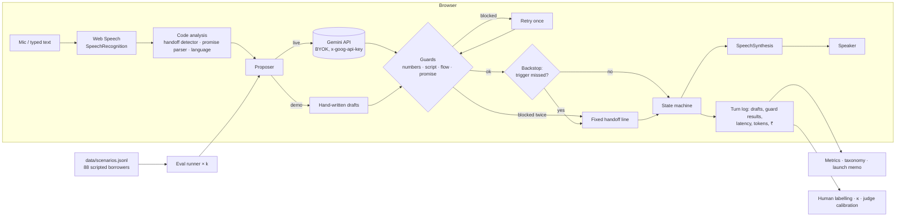

# Kisht

**A Hinglish / Marathi-English voice agent that makes pre-due EMI reminder calls for a lender, and the evaluation and launch decision for it.**

> **Honesty notes, up front**
> - **Sahayak Finance is fictional.** No real lender, loan or borrower is represented. All data is sample data.
> - **No eval results exist yet.** Every metric in the app and in `docs/RESULTS.md` says "not run yet" until a real run happens in your browser. Nothing is pre-filled.
> - **Scenarios were drafted with AI assistance; reviewed by Vishnu before results are published.** See `REVIEW.md`.
> - **Demo mode replays 3 hand-written transcripts, labelled "hand-written example, not model output".** The guards run on them for real; the agent lines are written by hand.
> - Built by Vishnu Yash Pandey (final-year CSE; ex-AI PM intern, Tata Teleservices).

## Problem

A pre-due reminder is the cheapest point in collections: nothing is missed yet; most borrowers just need a nudge and a date. Lenders use SMS (ignored) or human callers (expensive). Many borrowers in Pune and Mumbai code-mix Hinglish, Marathi-English and Hindi, and aren't comfortable in English.

**Users:** the lender's collections/ops lead (wants fewer human calls and recorded promise dates, without compliance risk) and the borrower (wants a short, polite call in their language, and a human when it's not simple).

## Why AI, and where AI is the risk

**Why AI:** borrowers answer in free-form, code-mixed speech, interrupt, and correct themselves mid-sentence ("8 ko… nahi nahi 10 ko de dunga"). They ask off-script questions ("byaj kitna hai?"). An IVR keypad tree can't capture that.

**Where it's the risk:** the model might invent a figure, miss a hardship or third-party handoff, record the wrong date, or pressure someone. So **the model proposes; code decides**:

| Guard (code) | What it does |
|---|---|
| Number guard | Every amount/date/%/duration in a draft must be on the policy card (or the code-validated promise date). Hinglish numerals ("chaar hazaar do sau pachaas"), ₹4,250, Devanagari digits, "5 Nov", "paanch tareekh". Block → retry once → handoff. |
| Handoff backstop | Detects disputes, hardship, wrong number, third party, rate/waiver questions, abuse and more on the borrower's turn; forces a handoff the model missed. |
| Promise parser | Reads the final date after self-corrections; validates it against the allowed window. |
| State machine | Greeting → identity → amount/date → FAQ → promise → close / handoff. Illegal transitions are blocked. |
| Script checks | Threats, sensitive-data asks, other people's loans, disclosure before identity. |
| Latency & ₹ | Per-turn model latency; token-based ₹ cost (configurable prices; estimates). |

## Solution

1. **Agent:** Gemini (BYOK, default `gemini-2.5-flash`), JSON output, guarded by code, with fixed greeting and handoff lines in 4 language varieties.
2. **Voice:** browser SpeechRecognition (hi-IN / en-IN / mr-IN) and SpeechSynthesis, with per-turn STT / LLM / TTS timings where measurable. Typing always works.
3. **Eval runner:** 88 scripted borrower scenarios × k=3 runs against the live model. Task completion, script compliance, invented-number rate, correct/unnecessary handoff, pass^k, p50/p95 latency, ₹ per resolved call, with breakdowns by language, persona and disruption. Results download as JSON.
4. **Human labelling:** two labellers on a seeded 25% sample, agreement % and Cohen's kappa; LLM judge allowed only for script compliance, and only after calibration (κ ≥ 0.6).
5. **Failure taxonomy** and a **launch memo** that fill from results and can say No-go.

## Tradeoffs (full log in `docs/DECISIONS.md`)

- **Fixed policy card over free answers:** fewer questions answered, but "invented number" becomes checkable.
- **Handoff-first:** lower containment, but missed hardship/third-party handoffs are the expensive failures.
- **Text pipeline + browser STT/TTS, not native audio:** slower and STT-limited, but every word is checked before it's spoken and the eval is reproducible.
- **BYOK, no backend:** reviewers need their own key, but there's no shared key to leak and nothing to host.
- **Scripted borrowers:** reproducible and measurable for consistency, but optimistic. Hence the real-user test.

## Architecture



## Screenshots

_Placeholder: add after the first real run (Overview, Call Simulator, Eval Runs, Failure Taxonomy, Launch Memo). Don't screenshot Stitch mockups; they contain invented numbers._

## How to run

```bash
npm install
npm run dev        # http://localhost:5173
npm test           # vitest: guards, parsers, state machine, scenarios, runner
npm run build      # type-check + production build to dist/
npm run scenarios  # regenerate data/scenarios.jsonl from scripts/build-scenarios.mjs
```

Deploy: static site; `vercel.json` is included (`npm run build` → `dist/`). Not deployed.

### BYOK (bring your own key)

1. Create a Gemini API key in Google AI Studio, **with a spending cap**.
2. Open Settings → paste the key. It stays in this tab's memory (optionally sessionStorage), is sent only to `generativelanguage.googleapis.com` in the `x-goog-api-key` header, and is **never** written to localStorage, exported JSON, logs or the repo. A test (`tests/runner.test.ts`) checks the key is never in the URL or the run JSON.
3. Eval Runs shows a rough cost estimate before you start. Prices and USD→INR are editable in Settings and labelled as estimates.

Without a key, the Call Simulator runs **demo mode** (hand-written transcripts).

### Browser support

Speech recognition works in Chromium-based browsers (Chrome, Edge); Firefox has no SpeechRecognition, so type instead. Available TTS voices vary by OS; `mr-IN` usually falls back to a Hindi voice.

## Repository map

```
docs/      PRD · POLICY_CARD · FAILURE_TAXONOMY · EVAL_PLAN · REAL_USER_TEST · DECISIONS · LAUNCH_MEMO · RESULTS · SOURCES
data/      scenarios.jsonl (88, AI-drafted, reviewed:false)
scripts/   build-scenarios.mjs (source of truth for scenarios)
src/lib/   numbers (guard) · promiseDate · handoff · stateMachine · agent (turn engine) · gemini · proposers · runner · metrics · kappa · judge · decision · taxonomy · language · scriptChecks · speech · settings · policyCard · templates
src/pages/ Overview · Simulator · EvalRuns · Taxonomy · LaunchMemo · Labelling · Settings
src/styles.css  single stylesheet: tokens, then components, then pages
tests/     vitest suites
```

## What I chose not to build

Telephony/PSTN, dialer, CRM, payment links, SMS, post-due collections, negotiation/settlements, a native speech-to-speech model (v0), a server, and analytics beyond what the launch decision needs.

## Sources

Conduct rules are drawn from RBI circulars (2022 recovery-agent responsibilities incl. 08:00–19:00 calling; 2015 NBFC Fair Practices Code on vernacular communication and harassment; 2008 recovery-agent guidelines). Full list and what was and wasn't verified: `docs/SOURCES.md`. A newer RBI 2025 NBFC conduct direction was **not** read and must be checked.
